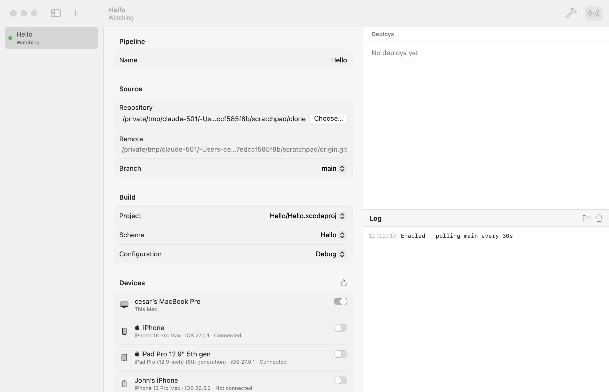

# Orchard

A macOS app that watches a git branch and, whenever it moves, builds the app and deploys it to the devices you pick — this Mac, paired iPhones/iPads/Apple TVs/Vision Pros, and booted simulators.



## Build & run

```bash
./scripts/build-app.sh --install
```

This builds `build/Orchard.app` and copies it to `~/Applications`. You can also open `Package.swift` in Xcode and run it.

Run the tests with `swift test`. CI runs them, plus the app bundle build, on every pull request.

## Releases

Every push to `main` builds a DMG (`./scripts/build-dmg.sh`) and publishes it as a [GitHub release](https://github.com/ambiapps/orchard/releases) tagged `v<version>(<build>)`, e.g. `v1.0.0(42)`. The version comes from [`VERSION`](VERSION); the build number is the CI run number. Release builds are signed with a Developer ID certificate and notarized by Apple, so they open without Gatekeeper warnings. Local builds from `./scripts/build-app.sh` are ad-hoc signed.

## Using it

1. **+** to add a pipeline, then **Choose…** a local clone of the repo.
2. Pick the branch, project/workspace, scheme, configuration and devices.
3. Toggle **Enable** in the toolbar. Orchard checks the branch head (`git ls-remote`) every poll interval and, when it changes, builds and deploys. **Build & Deploy Now** forces a run.

Orchard keeps running in the menu bar after the window closes.

## How it works

- **Checkout:** a private detached `git worktree` per pipeline in `~/Library/Application Support/Orchard/Pipelines/<id>/` — your own checkout is never touched (other than `git fetch`).
- **Build:** one `xcodebuild build` per platform (`generic/platform=iOS`, `platform=macOS`, …) with automatic signing (`-allowProvisioningUpdates`), so all iPhones and iPads share one build.
- **Deploy:** `devicectl device install app` + `process launch --terminate-existing` for devices, `simctl install/launch` for simulators, quit + `open` for this Mac.
- A commit that fails isn't retried on every poll; push a new one or use **Build & Deploy Now**.
- Full logs per run are in `~/Library/Logs/Orchard/<id>/`.

## Requirements

macOS 15+, Xcode with a signed-in developer account for physical devices, and devices that are paired with Xcode and have Developer Mode on. Devices must be registered in your team (deploying once from Xcode does this).
