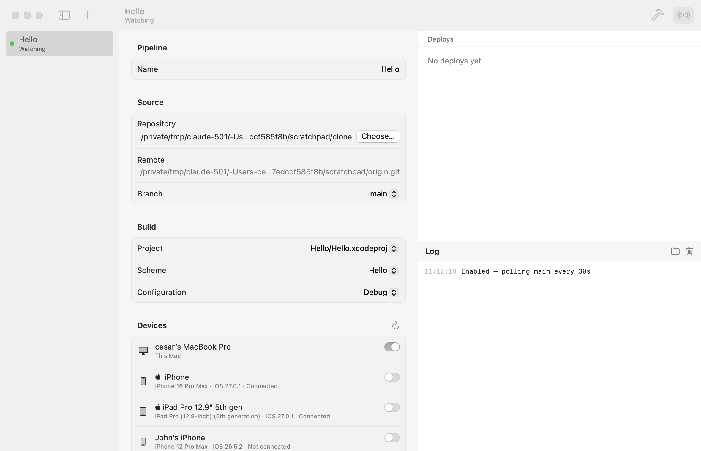

# Orchard

A macOS app that watches a git branch and, whenever it moves, builds the app and deploys it to the devices you pick — this Mac, paired iPhones/iPads/Apple TVs/Vision Pros, and booted simulators.



## Build & run

```bash
./scripts/build-app.sh --install
```

This builds `build/Orchard.app` and copies it to `~/Applications`. You can also open `Package.swift` in Xcode and run it.

Run the tests with `swift test`. CI runs them, plus the app bundle build, on every pull request.

## Releases

Every push to `main` builds a DMG (`./scripts/build-dmg.sh`) and publishes it as a [GitHub release](https://github.com/ambiapps/orchard/releases) tagged `v<version>(<build>)`, e.g. `v1.0.0(42)`. The version comes from [`VERSION`](VERSION); the build number is the CI run number. The app is ad-hoc signed, not notarized, so after the first launch attempt allow it in **System Settings › Privacy & Security › Open Anyway** (or run `xattr -dr com.apple.quarantine /Applications/Orchard.app`).

Orchard checks for a new release each time it starts. When one is out it shows a small **Update Available** window with a link to the release notes: **Install and Relaunch** downloads the DMG, replaces the app in place and reopens it; **Skip This Version** stops the reminders for that release. **Check for Updates…** is in the app menu and the menu bar menu. Self-updating needs write access to the folder Orchard lives in; otherwise the pop-up links to the download.

On a Mac nobody sits at (a build machine you reach over SSH or screen sharing), turn on **Install Updates Automatically** in the app menu or the menu bar menu, or from a shell:

```bash
defaults write se.ambi.Orchard automaticallyInstallUpdates -bool YES
```

Orchard then checks for a release every hour and installs it without asking. It waits for running builds and deploys to finish first, and relaunches with the same pipelines enabled. It's off by default, and a `defaults write` on a running Orchard takes effect within the hour. A version you skipped stays skipped. A download that fails is tried again at the next check; a release that downloaded but couldn't replace the app isn't.

## Using it

1. **+** to add a pipeline, then **Choose…** a local clone of the repo.
2. Pick the branch, project/workspace, scheme, configuration and devices.
3. Toggle **Enable** in the toolbar. Orchard checks the branch head (`git ls-remote`) every poll interval and, when it changes, builds and deploys. **Build & Deploy Now** forces a run.

Orchard keeps running in the menu bar after the window closes.

### Headless Macs: set up devices automatically

For a Mac nobody sits at (say, a Mac Studio in the office), turn on **Settings → Set up connected devices automatically**. It's off by default. With it on, adding a phone takes no clicks on the Mac:

1. Plug the device into the Mac with a cable, unlock it and tap **Trust**.
2. If Developer Mode is off, the device asks to turn it on (or use Settings → Privacy & Security → Developer Mode) and restarts. Apple doesn't let a Mac do this.
3. Unplug it. Orchard deploys to it over Wi-Fi from then on, as long as it's on the same network as the Mac.

Orchard checks `devicectl list devices` every 10 seconds, pairs a device that shows up unpaired on a cable (`devicectl manage pair`, asked again until Trust is tapped), mounts the developer disk image (`devicectl device info ddiServices`; the first time needs internet access), and adds the device to every pipeline whose **Deploy to new devices** toggle is on (the default). Enabled pipelines then deploy their branch head to it right away, with the device as xcodebuild's destination so it's registered with your team. Pairing over the cable is all Wi-Fi needs: CoreDevice finds paired devices on the local network by itself. Each device's progress shows on its row in the device list and in `~/Library/Logs/Orchard/devices.log`; a step that fails is tried again on the next check. Devices you paired yourself are never touched, and the phone has to be on a network where Bonjour reaches the Mac (not a guest network that isolates clients).

### Builder and clients: builds for people without Xcode

One Mac builds; other Macs install its builds on their own devices, without Xcode, the source code or git access. That suits designers and testers, also remote ones.

**On the builder** (the Mac that has pipelines), turn on **Settings → Share builds with other Macs**. From the next build on, each pipeline's app is also zipped and served on port 8642. Settings shows a link, `http://<host>:8642`: send it to the clients. For people outside the office network, replace the host with a name they can reach over your VPN or Tailscale. To build iOS when the builder itself has no iPhone chosen, set the pipeline's **Also build for**.

**On a client**, paste the link into **Settings → Builder link**. The client shows a six-digit code and the builder's Settings lists the client as waiting: enter its code there and click **Approve** (or **Decline**). Approved Macs are listed on the builder, where **Remove** cuts one off. Then the builder's pipelines appear in the main window; choose your devices and enable them. Orchard then asks the builder for new builds (every minute by default), downloads each one and installs and launches it.

A client needs no Xcode. `devicectl` comes from a 150 MB Apple-signed package inside the builder's Xcode (`XcodeSystemResources.pkg`); the device list offers to **Install…** it from the builder, after checking Apple's signature, and macOS asks for an administrator password. To pair a phone with a client, turn on **Set up connected devices automatically** there and plug it in.

Things to know:

- A phone has to be in the app's provisioning profile, so register it with your team first: plug it into the builder once with automatic setup on (then untick it there, or the builder keeps trying to reach it), or add its UDID in the developer portal. A client says so when a device isn't in the profile.
- Development builds need Developer Mode on the phone.
- Only Macs approved on the builder can download builds; each has its own token. Traffic is plain HTTP, though, so use it on a network you trust or over a VPN. Links from Orchard 1.0.14 and earlier still work, but each client has to be approved once.
- The builder keeps one build per pipeline and platform, the latest.

## How it works

- **Checkout:** a private detached `git worktree` per pipeline in `~/Library/Application Support/Orchard/Pipelines/<id>/` — your own checkout is never touched (other than `git fetch`).
- **Build:** one `xcodebuild build` per platform (`generic/platform=iOS`, `platform=macOS`, …) with automatic signing (`-allowProvisioningUpdates`), so all iPhones and iPads share one build. Builds are incremental (each pipeline keeps its own DerivedData) and skip dSYMs (`DEBUG_INFORMATION_FORMAT=dwarf`), which deploys don't need. If the app's provisioning profile doesn't list a chosen device (Xcode's cached profile predates it), Orchard deletes Xcode's cached managed profiles and builds once more; a device that's still missing fails with a message to register it. A build phase that requires a dSYM, such as a strict crash-reporter upload script, won't find one.
- **Deploy:** `devicectl device install app` + `process launch --terminate-existing` for devices, `simctl install/launch` for simulators, quit + `open` for this Mac. Devices that share a build are deployed to at the same time.
- A commit that fails isn't retried on every poll; push a new one or use **Build & Deploy Now**.
- If the app installs but can't launch (for example, the phone is locked), the deploy shows a warning instead of failing and counts as deployed.
- When a device fails or the app doesn't launch on it (disconnected, locked), click its name in the deploy to install and launch the same build on it again, without rebuilding. That works for the most recent build, until the next one starts.
- Each deploy lists the commits it brings in since the last successful deploy (`git log <last>..<new>`, up to 50). Nothing is listed when the new commit doesn't descend from the last one (force-push, rollback, branch switch).
- Full logs per run are in `~/Library/Logs/Orchard/<id>/`. The deploy list and the log in the window are kept there too (`runs.json`, `activity.jsonl`), so they survive a relaunch. Both keep the last 20 builds (set per pipeline under Polling; lowering it trims right away), and both show how long checkout, build and deploy took.

## Requirements

A Mac that only installs a builder's builds needs macOS 15+ and nothing else. To build: macOS 15+, Xcode with a signed-in developer account for physical devices, and devices that are paired with Xcode and have Developer Mode on. Devices must be registered in your team (deploying once from Xcode does this). With automatic setup on, Orchard pairs and registers devices itself.
